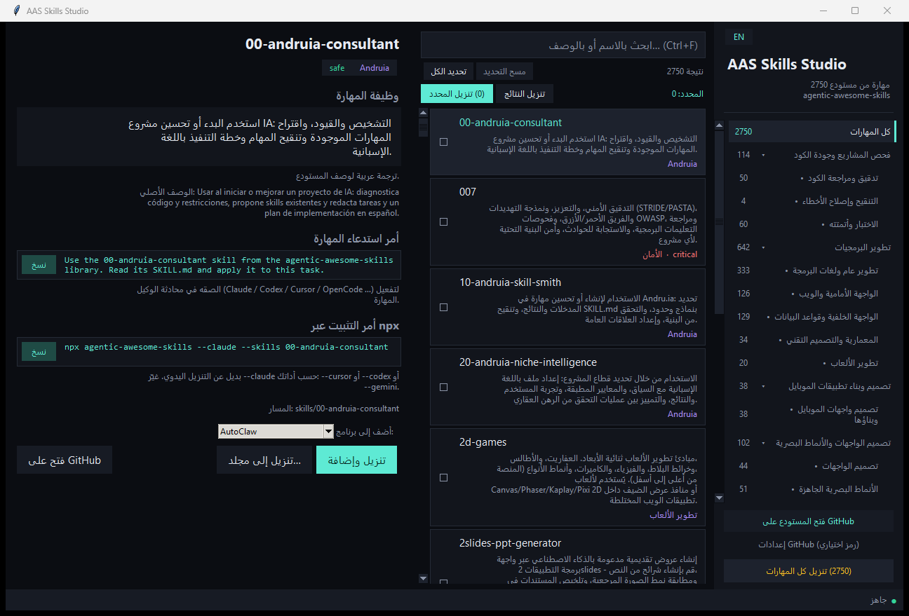
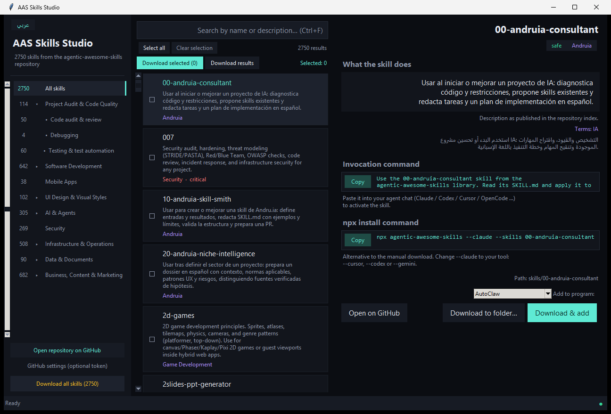
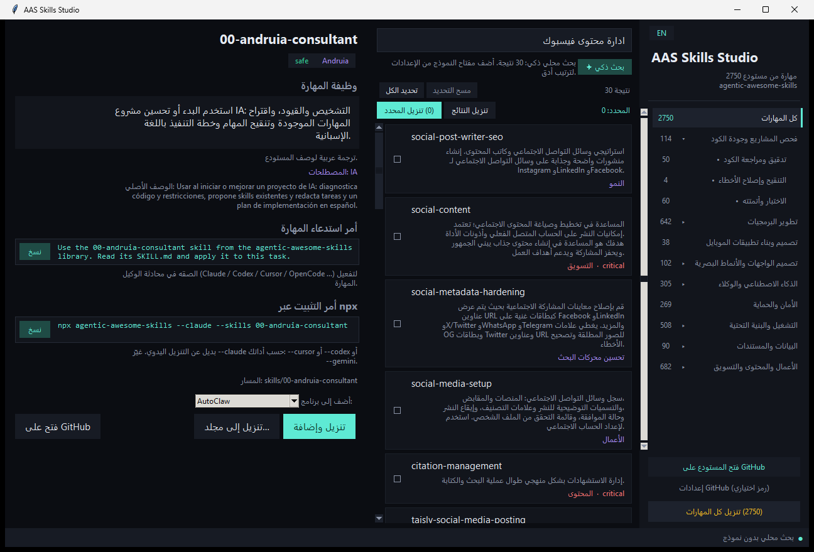
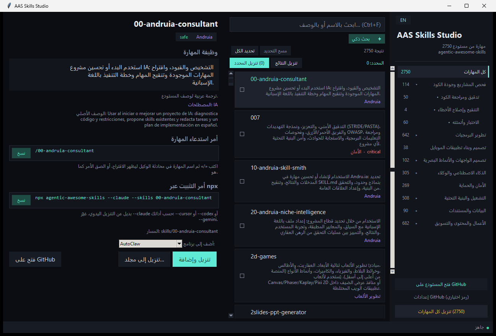

# AAS Skills Studio

**متصفّح مهارات بواجهة عربية/إنجليزية — لتصفّح وتنزيل 2750 مهارة جاهزة من مستودع
[`agentic-awesome-skills`](https://github.com/sickn33/agentic-awesome-skills) وإضافتها
إلى أدواتك بضغطة واحدة.**

**A bilingual desktop browser for the 2,750-skill `agentic-awesome-skills` library —
browse, search in plain Arabic/English, download, and install into your AI tool.**

<p>
  
  
  
  
  
  
</p>



<p align="center">
  <a href="#العربية">العربية</a> ·
  <a href="#english">English</a>
</p>

---

<a id="العربية"></a>

# العربية

## نظرة سريعة

`AAS Skills Studio` تطبيق سطح مكتب واحد (ملف `.exe` مستقل، بدون تثبيت) يعرض فهرس
مهارات مستودع `agentic-awesome-skills` كاملاً — **2750 مهارة** — بواجهة عربية
أصلية (RTL) وإنجليزية، مع بحث ذكي يفهم الطلب باللغة الطبيعية، وتنزيل مباشر
إلى مجلد مهارات البرنامج الذي تستخدمه.

> المشروع أداة مستقلة للتصفّح والتنزيل. المهارات نفسها ملك لأصحابها في مستودع
> `sickn33/agentic-awesome-skills`، وهذا المشروع غير مرتبط به رسمياً.

## المزايا

| الميزة | التفاصيل |
|---|---|
| الفهرس الكامل | 2750 مهارة في **9 مجموعات رئيسية و23 قسماً فرعياً** بدل 115 تصنيفاً متشابكاً |
| لغتان | زر `EN / عربي` يبدّل الواجهة كاملة ويقلب التخطيط (RTL ↔ LTR) |
| وصف عربي لكل مهارة | 39 شرحاً يدوياً + 2711 ترجمة عربية لوصف المستودع، مع الوصف الأصلي أسفلها |
| بحث ذكي بالعربية | يفهم «مهارة لتحليل مشروع» و«إدارة محتوى فيسبوك» عبر قاموس مفاهيم وترجيح IDF |
| Gemini اختياري | يرتّب أفضل 8 نتائج ويشرح سبب اختيار كل مهارة، ويرجع للبحث المحلي عند الفشل |
| اختيار متعدد | مربّع لكل مهارة + «تحديد الكل» على نتائج الفلترة + عدّاد المحدد |
| تنزيل مرن | تنزيل المهارة، أو المحدد، أو نتائج الفئة، أو الكل (2750) |
| إضافة لبرنامجك | 12 هدفاً جاهزاً، كل هدف يكتب في مجلد المهارات الصحيح لبرنامجه |
| أمر استدعاء جاهز | صيغة الشرطة المائلة `/skill-id` كما تظهر في قوائم الأدوات، مع زر نسخ |
| سجل وإلغاء | ملف `aas-download-log.txt` داخل مجلد الوجهة + زر إلغاء أثناء التنزيل |
| رمز GitHub اختياري | يرفع حد الطلبات من 60 إلى 5000/ساعة للتنزيل الجماعي |
| بدون تبعيات | وقت التشغيل: مكتبة Python القياسية فقط (tkinter) |

## لقطات الشاشة

| الواجهة العربية | الواجهة الإنجليزية |
|---|---|
|  |  |

| البحث الذكي | أمر الاستدعاء |
|---|---|
|  |  |

## التثبيت

### 1) الملف التنفيذي (الطريقة الأسهل)

المستودع لا يخزّن ملفات `.exe` داخل Git (لتبقى الحزمة خفيفة). ابنِ الملف محلياً
بأمر واحد كما في [بناء الملف التنفيذي](#بناء-الملف-التنفيذي)، أو نزّله من صفحة
**Releases** إن كانت متاحة.

### 2) التشغيل من المصدر

المتطلبات: Windows + Python 3.14 مع tkinter (مضمّن في مثبّت Python الرسمي).

```bash
git clone https://github.com/<account>/aas-skills-studio.git  # or your fork URL
cd aas-skills-studio
py -3.14 app.py
```

أو بدون نافذة سوداء:

```bat
run_silent.bat
```

لا توجد تبعيات خارجية — لا `pip install`.

## الاستخدام

1. اختر تصنيفاً من الشريط الجانبي (المجموعات التسع، وكل مجموعة تُظهر أقسامها).
2. اكتب طلبك في مربع البحث، ثم:
   - كتابة عادية → فلترة فورية بالاسم والوصف.
   - **Enter** أو **✦ بحث ذكي** → بحث دلالي بالعربية.
3. اختر مهارة لعرض: وظيفتها، المصطلحات، أمر الاستدعاء `/skill-id`، أمر التثبيت، والمسار.
4. اختر برنامجك من «أضف إلى برنامج» ثم **تنزيل وإضافة**.
5. للجملة الكبيرة: حدّد عدة مهارات (أو «تحديد الكل») ثم **تنزيل المحدد**.

## الإضافة إلى أدواتك

| الأداة | المسار |
|---|---|
| AutoClaw | `~/.openclaw-autoclaw/skills/` |
| OpenClaw / Antigravity | `~/.agents/skills/` |
| Antigravity CLI (`agy`) | `~/.gemini/antigravity-cli/skills/` |
| Claude Code | `~/.claude/skills/` |
| Codex CLI | `~/.codex/skills/` |
| Gemini CLI | `~/.gemini/skills/` |
| Kiro (CLI/IDE) | `~/.kiro/skills/` |
| Autohand Code | `~/.autohand/skills/` |
| Cursor | `<project>/.cursor/skills/` |
| OpenCode | `<project>/.agents/skills/` |
| AdaL CLI | `<project>/.adal/skills/` |
| مجلد مخصص | أي مسار تختاره |

تُحفظ المهارة كـ `<id>/SKILL.md` — الشكل الذي تقرأه هذه الأدوات. أعد تشغيل
الأداة الهدف لتظهر المهارة في قائمتها.

## البحث الذكي

**محلياً (بدون إنترنت):** قاموس مفاهيم يربط العربية بالإنجليزية (فيسبوك →
facebook/social، تحليل → audit/review…)، مع ترجيح IDF حتى لا تطغى الكلمات
الشائعة مثل «إدارة» على الكلمات المحددة مثل «فيسبوك».

**عبر Gemini (اختياري):** من **الإعدادات** أضف مفتاح Google Gemini واختر النموذج
(`gemini-2.5-flash` افتراضياً، أو `2.5-pro`، `2.5-flash-lite`، `2.0-flash`).
يرسل أفضل 60 مرشحاً محلياً ويعيد أفضل 8 مع سبب عربي لكل اختيار وجملة تشرح ما
فهمه من الطلب. المفتاح يُحفظ محلياً في
`%APPDATA%\AAS-Skills-Studio\settings.json` ولا يُرفع لأي مكان.

## سطر الأوامر

```bash
AAS-Skills-Studio.exe --selftest
AAS-Skills-Studio.exe --download-test mobile-design C:\Skills
AAS-Skills-Studio.exe --bulk-test 3 C:\Skills
```

| الأمر | الوظيفة |
|---|---|
| `--selftest` | يتحقق من الفهرس والتصنيفات ويطبع `SELFTEST OK …` |
| `--download-test <id> <dir>` | ينزّل مهارة واحدة ويفشل إن لم يوجد `SKILL.md` غير فارغ |
| `--bulk-test <n> <dir>` | يختبر حلقة التنزيل المتعدد |

## بناء الملف التنفيذي

```bash
py -3.14 -m pip install pyinstaller
py -3.14 -m PyInstaller --noconfirm --onefile --windowed ^
  --name AAS-Skills-Studio ^
  --add-data "data/catalog.json;data" ^
  --add-data "data/groups.json;data" ^
  --add-data "data/skills.json;data" ^
  --hidden-import search_engine app.py
```

الناتج: `dist\AAS-Skills-Studio.exe` (حوالي 13 MB).

## بنية المشروع

```text
app.py                 واجهة tkinter ومنطق التنزيل والأهداف
search_engine.py       البحث الذكي المحلي + استدعاء Gemini
data/
  catalog.json         الفهرس الكامل (2750 مهارة + أوصاف عربية + مصطلحات)
  groups.json          شجرة التصنيفات (9 مجموعات / 23 قسماً)
  skills.json          الأوصاف العربية اليدوية (39 مهارة)
tools/
  build_catalog.py     بناء catalog.json من skills_index.json الرسمي
  translate_catalog.py إضافة الترجمة العربية (مع تخزين مؤقت)
  enrich_arabic.py     تحسين الأوصاف الغامضة واستخراج المصطلحات
  check_groups.py      التحقق أن كل تصنيف مُسند مرة واحدة
docs/screenshots/      صور الواجهة
run_silent.bat         تشغيل من المصدر بدون نافذة سوداء
AAS-Skills-Studio.spec وصفة PyInstaller
```

## تحديث البيانات

```bash
py -3.14 tools/build_catalog.py <path-to-skills_index.json>
py -3.14 tools/translate_catalog.py
py -3.14 tools/enrich_arabic.py
py -3.14 tools/check_groups.py
```

`data/ar_cache.json` ذاكرة ترجمة محلية تُستثنى من Git.

## حدود وملاحظات صريحة

- **الأوصاف العربية:** 39 يدوية و2711 مترجمة آلياً من وصف المستودع؛ قد تكون
  بعض الصياغات حرفية. الوصف الإنجليزي الأصلي يظهر دائماً أسفل الشرح العربي.
- **تصنيفات المجموعات التسع** اجتهاد في التجميع، وليست تصنيفاً رسمياً في المستودع.
- **التنزيل الجماعي** يحتاج رمز GitHub للحد الأعلى؛ بدونه يتوقف عند 60 طلباً/ساعة.
- **Gemini** اختياري تماماً؛ لم تُختبر جودة ترتيبه بمفتاح صالح في هذا المستودع.
- المهارات الموسومة `critical` قد تنفّذ أوامر أو تعدّل ملفات — راجع `SKILL.md` قبل التشغيل.
- التطبيق لم يُختبر إلا على Windows 11 بدقة 1920×1080.

## الترخيص

كود هذا المشروع تحت [MIT](LICENSE). المهارات ومحتواها تخضع لترخيص
`agentic-awesome-skills` الأصلي وأصحابها.

---

<a id="english"></a>

# English

## Overview

**AAS Skills Studio** is a portable Windows desktop app (single `.exe`, no install)
that browses the full **2,750-skill** catalog of
[`sickn33/agentic-awesome-skills`](https://github.com/sickn33/agentic-awesome-skills)
in Arabic (native RTL) and English, with natural-language Arabic search and
one-click installation into your AI tool's skills folder.

> Independent companion tool. The skills belong to their authors in the
> `agentic-awesome-skills` repository; this project is not affiliated with it.

## Features

| Feature | Details |
|---|---|
| Full catalog | 2,750 skills organized into **9 groups / 23 subsections** instead of 115 loose categories |
| Bilingual UI | `EN / عربي` toggle switches every label and mirrors the layout (RTL ↔ LTR) |
| Arabic description per skill | 39 hand-written + 2,711 translated from the repo description, with the English original underneath |
| Natural-language search | Understands «مهارة لتحليل مشروع» / «إدارة محتوى فيسبوك» via an Arabic↔English concept map and IDF weighting |
| Optional Gemini | Reranks the top 8 candidates with a short reason each; falls back to local results on failure |
| Multi-select | Checkbox per skill, select-all on filtered results, live counter |
| Flexible download | Single skill, selected, current results, or all 2,750 |
| Install into your tool | 12 built-in targets, each writing to that tool's real skills directory |
| Ready invocation | Slash form `/skill-id` as shown in tool command palettes, with one-click copy |
| Logging & cancel | `aas-download-log.txt` in the destination plus a cancel button |
| Optional GitHub token | Raises the API limit from 60 to 5,000 requests/hour for bulk downloads |
| Zero dependencies | Runtime uses the Python standard library only (tkinter) |

## Screenshots

| Arabic UI | English UI |
|---|---|
|  |  |

| Smart search | Slash invocation |
|---|---|
|  |  |

## Install

### Option A — prebuilt executable

Binaries are not committed to Git. Build one locally (see
[Build the executable](#build-the-executable)) or grab it from the **Releases**
page when available.

### Option B — run from source

Requirements: Windows + Python 3.14 with tkinter (bundled in the official installer).

```bash
git clone https://github.com/<account>/aas-skills-studio.git  # or your fork URL
cd aas-skills-studio
py -3.14 app.py
```

No `pip install` needed.

## Usage

1. Pick a group in the sidebar (expandable into its subsections).
2. Type your request in the search box:
   - plain typing filters by name/description instantly;
   - **Enter** or **✦ Smart search** runs the semantic Arabic search.
3. Select a skill to see its purpose, English terms, `/skill-id` invocation,
   npx install command and repository path.
4. Choose your tool under “Add to program”, then **Download & add**.
5. For bulk work, check several skills (or “Select all”) and hit **Download selected**.

## Supported targets

| Tool | Directory |
|---|---|
| AutoClaw | `~/.openclaw-autoclaw/skills/` |
| OpenClaw / Antigravity | `~/.agents/skills/` |
| Antigravity CLI (`agy`) | `~/.gemini/antigravity-cli/skills/` |
| Claude Code | `~/.claude/skills/` |
| Codex CLI | `~/.codex/skills/` |
| Gemini CLI | `~/.gemini/skills/` |
| Kiro (CLI/IDE) | `~/.kiro/skills/` |
| Autohand Code | `~/.autohand/skills/` |
| Cursor | `<project>/.cursor/skills/` |
| OpenCode | `<project>/.agents/skills/` |
| AdaL CLI | `<project>/.adal/skills/` |
| Custom folder | any path you choose |

Skills are written as `<id>/SKILL.md`, the layout these tools expect. Restart the
target tool to pick them up.

## Smart search

**Local (offline):** a concept map links Arabic phrases to English keywords
(فيسبوك → facebook/social, تحليل → audit/review) with IDF weighting so common
words like «إدارة» do not drown out specific ones like «فيسبوك».

**Gemini (optional):** add a Google Gemini API key in **Settings** and pick a model
(`gemini-2.5-flash` by default, or `2.5-pro`, `2.5-flash-lite`, `2.0-flash`). The app
sends the top 60 local candidates and asks for the best 8 with a one-line Arabic
reason and a summary of the understood intent. The key is stored locally in
`%APPDATA%\AAS-Skills-Studio\settings.json` and is never uploaded anywhere else.

## CLI

| Command | Purpose |
|---|---|
| `--selftest` | Validates catalog/taxonomy, prints `SELFTEST OK …` |
| `--download-test <id> <dir>` | Downloads one skill; fails without a non-empty `SKILL.md` |
| `--bulk-test <n> <dir>` | Exercises the multi-download loop |

## Build the executable

```bash
py -3.14 -m pip install pyinstaller
py -3.14 -m PyInstaller --noconfirm --onefile --windowed ^
  --name AAS-Skills-Studio ^
  --add-data "data/catalog.json;data" ^
  --add-data "data/groups.json;data" ^
  --add-data "data/skills.json;data" ^
  --hidden-import search_engine app.py
```

Output: `dist\AAS-Skills-Studio.exe` (~13 MB).

## Project layout

```text
app.py                 tkinter UI, download engine, install targets
search_engine.py       local semantic search + Gemini reranking
data/catalog.json      full catalog (2,750 skills, Arabic text, terms)
data/groups.json       9-group / 23-subsection taxonomy
data/skills.json       39 hand-written Arabic descriptions
tools/                 catalog build, translation, enrichment, validation
docs/screenshots/      UI screenshots
run_silent.bat         run from source without a console window
AAS-Skills-Studio.spec PyInstaller recipe
```

## Data refresh

```bash
py -3.14 tools/build_catalog.py <path-to-skills_index.json>
py -3.14 tools/translate_catalog.py
py -3.14 tools/enrich_arabic.py
py -3.14 tools/check_groups.py
```

`data/ar_cache.json` is a local translation cache and is git-ignored.

## Known limitations

- **Arabic text:** 39 descriptions are hand-written and 2,711 are machine-translated
  from the repository's own descriptions; some phrasing is literal. The English
  original is always shown under the Arabic text.
- The 9-group taxonomy is an editorial grouping, not an official one.
- **Bulk download** needs a GitHub token to stay under the API limit (60/hour without).
- **Gemini** is entirely optional; its ranking quality was not verified with a valid key here.
- Skills marked `critical` may execute commands or modify files — review `SKILL.md` first.
- Tested only on Windows 11 at 1920×1080.

## License

Code: [MIT](LICENSE). Skills and their content remain under the original
`agentic-awesome-skills` license and their authors' terms.
